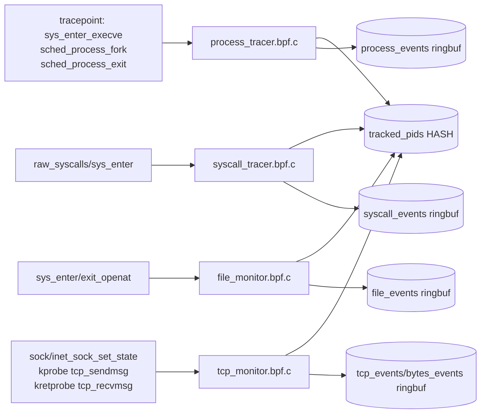
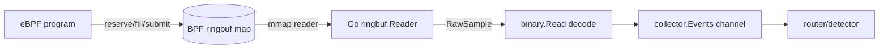
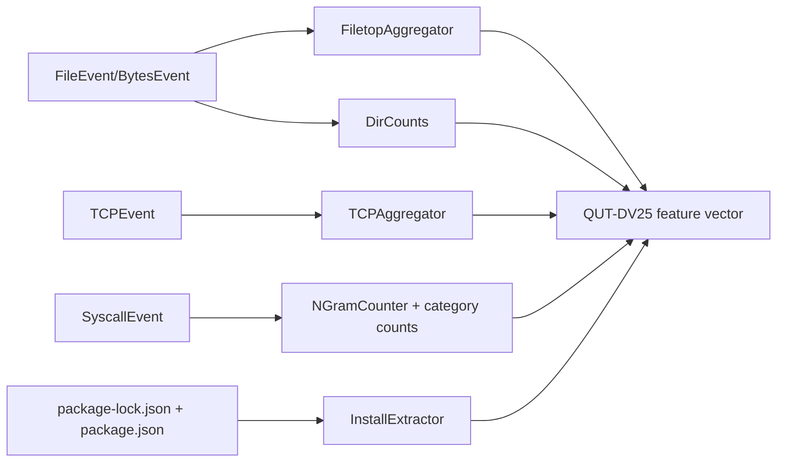
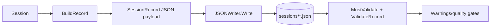

# npm-ebpf-monitor Architecture Deep Dive

This document explains the six core architecture layers requested for the capstone demo.
Each section includes:

- a concise summary,
- a deeper technical explanation,
- a **dataflow diagram** (first diagram style), and
- medium-sized code snippets (Option B).

---

## 1) eBPF Kernel Probe Layer (Four CO-RE Programs)

### Summary

The kernel layer is split into four focused CO-RE programs:

- `process_tracer.bpf.c` (exec/fork/exit lifecycle)
- `syscall_tracer.bpf.c` (all syscalls for tracked processes)
- `file_monitor.bpf.c` (`openat` enter/exit with directory categorisation)
- `tcp_monitor.bpf.c` (TCP state transitions + byte transfer probes)

The key unifying design is the shared `tracked_pids` hash map. The process tracer seeds and maintains it; all other probes use it as a fast filter.

### Why these hook points

- **Process tracer:** tracepoints on `sys_enter_execve`, `sched_process_fork`, `sched_process_exit` are stable and provide complete lifecycle transitions.
- **Syscall tracer:** `raw_syscalls/sys_enter` gives a single high-coverage ingress for syscall behavior vectors.
- **File monitor:** `sys_enter_openat` + `sys_exit_openat` captures intent + success/failure and allows transient state across enter/exit.
- **TCP monitor:** uses **tracepoint** `sock/inet_sock_set_state` for stable ABI and robust context; uses kprobe/kretprobe only where no suitable tracepoint exists (`tcp_sendmsg`, `tcp_recvmsg`).

### Shared-map design (`tracked_pids`)

`tracked_pids` turns four independent programs into one coordinated monitor:

1. Process tracer identifies npm/node roots and descendants.
2. It inserts PID lineage (`pid -> ppid`) into `tracked_pids`.
3. Syscall/file/tcp probes check membership (`is_tracked`) and emit only relevant events.
4. Process-exit path removes dead TGIDs to prevent map growth.

This gives low-overhead, high-selectivity telemetry under npm install bursts.

### Diagram (Dataflow)



### Code snippet: process tracer map + lifecycle hooks

```c
struct {
    __uint(type, BPF_MAP_TYPE_HASH);
    __type(key, __u32);
    __type(value, __u32);
    __uint(max_entries, 4096);
} tracked_pids SEC(".maps");

SEC("tp/sched/sched_process_fork")
int tracepoint__sched__sched_process_fork(struct trace_event_raw_sched_process_fork *ctx)
{
    __u32 parent_pid = (__u32)ctx->parent_pid;
    __u32 child_pid  = (__u32)ctx->child_pid;

    if (!is_tracked(parent_pid))
        return 0;

    bpf_map_update_elem(&tracked_pids, &child_pid, &parent_pid, BPF_ANY);
    return 0;
}

SEC("tracepoint/sched/sched_process_exit")
int tracepoint__sched__sched_process_exit(struct trace_event_raw_sched_process_template *ctx)
{
    __u64 pid_tgid = bpf_get_current_pid_tgid();
    __u32 tid  = (__u32)pid_tgid;
    __u32 tgid = (__u32)(pid_tgid >> 32);
    if (tid != tgid || !is_tracked(tgid))
        return 0;
    bpf_map_delete_elem(&tracked_pids, &tgid);
    return 0;
}
```

### Code snippet: TCP tracepoint rationale in code

```c
// WHY tracepoint/sock/inet_sock_set_state instead of kprobing tcp_set_state?
// 1. STABILITY: tracepoint is ABI-stable; tcp_set_state may be inlined.
// 2. CONTEXT: oldstate/newstate are committed and consistent.
// 3. RICHNESS: family/protocol/saddr/daddr/sport/dport are provided.
// 4. CORRECTNESS: catches every transition across kernel builds.
SEC("tp/sock/inet_sock_set_state")
int tracepoint__sock__inet_sock_set_state(
    struct trace_event_raw_inet_sock_set_state *ctx)
{
    if (ctx->family != AF_INET)
        return 0;

    __u64 skaddr = (__u64)(uintptr_t)ctx->skaddr;
    __u64 pid_tgid = bpf_get_current_pid_tgid();
    __u32 tgid     = (__u32)(pid_tgid >> 32);

    if (tgid > 0 && is_tracked(tgid)) {
        bpf_map_update_elem(&sock_to_pid, &skaddr, &tgid, BPF_ANY);
    }
    // fallback to sock_to_pid in softirq context
    // emit tcp_event to ring buffer
    return 0;
}
```

---

## 2) Ring Buffer Transport (`BPF_MAP_TYPE_RINGBUF`)

### Summary

All event streams are transported through ring buffers, not perf buffers. This matches the timeline decision: lower overhead, no per-CPU buffer duplication, and strong throughput under npm bursts.

### Why ring buffer here

- **Single shared buffer per map** (avoids per-CPU memory multiplication).
- **mmap-backed producer/consumer model** in userspace reader (`ringbuf.Reader`).
- **Low-copy flow** from kernel reservation (`bpf_ringbuf_reserve`) to userspace decode.
- **Predictable backpressure semantics** (`reserve` fails when full; userspace can drop downstream if needed).

In this repo, every collector follows the same pattern: open `ringbuf.NewReader`, loop on `Read`, decode with `binary.Read`, and forward to buffered channel.

### Diagram (Dataflow)



### Code snippet: kernel producer side

```c
struct {
    __uint(type, BPF_MAP_TYPE_RINGBUF);
    __uint(max_entries, 1024 * 1024);
} syscall_events SEC(".maps");

SEC("tp/raw_syscalls/sys_enter")
int tracepoint__raw_syscalls__sys_enter(struct trace_event_raw_sys_enter *ctx)
{
    __u64 pid_tgid = bpf_get_current_pid_tgid();
    __u32 tgid     = (__u32)(pid_tgid >> 32);
    if (!is_tracked(tgid))
        return 0;

    struct syscall_event *evt;
    evt = bpf_ringbuf_reserve(&syscall_events, sizeof(*evt), 0);
    if (!evt)
        return 0;

    evt->pid = tgid;
    evt->syscall_id = (__u32)ctx->id;
    evt->timestamp_ns = bpf_ktime_get_ns();
    bpf_ringbuf_submit(evt, 0);
    return 0;
}
```

### Code snippet: Go consumer side

```go
func (c *SyscallCollector) Run(ctx context.Context) {
    go func() {
        <-ctx.Done()
        _ = c.reader.Close()
    }()

    for {
        record, err := c.reader.Read()
        if err != nil {
            if errors.Is(err, ringbuf.ErrClosed) {
                return
            }
            continue
        }

        var evt SyscallEvent
        if err := binary.Read(bytes.NewReader(record.RawSample), binary.LittleEndian, &evt); err != nil {
            continue
        }

        select {
        case c.Events <- evt:
        default:
            // Consumer is lagging; drop rather than block.
        }
    }
}
```

---

## 3) Go Userspace Collector Layer (`bpf2go` + `cilium/ebpf`)

### Summary

This layer bridges CO-RE kernel code to Go runtime:

1. `go:generate` invokes `bpf2go` to compile C programs and generate typed bindings.
2. Generated files embed `.o` bytecode in Go binaries.
3. Runtime loaders call `Load*Objects` and attach programs to tracepoints/probes.
4. `MapReplacements` injects the already-loaded `tracked_pids` map into later collections.

This is what provides practical portability and shared-state wiring.

### CO-RE portability bridge

- CO-RE relocation is handled in compiled objects.
- `cilium/ebpf` loads collection specs from embedded byte slices.
- Generated `*Objects` structs give strongly-typed map/program handles.
- All collectors share one kernel `tracked_pids` map FD via `MapReplacements`.

### Diagram (Dataflow)

```mermaid
flowchart LR
    C[bpf/*.bpf.c] --> G[go generate bpf2go]
    G --> O[embedded *.o in *_bpfel.go]
    O --> L[Load*Objects()]
    L --> M[MapReplacements tracked_pids]
    M --> A[Attach tracepoints/kprobes]
    A --> R[ringbuf readers + channels]
```

### Code snippet: generation + embedded bytecode loader

```go
//go:generate go run github.com/cilium/ebpf/cmd/bpf2go -target amd64 ProcessTracer ../../bpf/process_tracer.bpf.c

func LoadProcessTracer() (*ebpf.CollectionSpec, error) {
    reader := bytes.NewReader(_ProcessTracerBytes)
    spec, err := ebpf.LoadCollectionSpecFromReader(reader)
    if err != nil {
        return nil, fmt.Errorf("can't load ProcessTracer: %w", err)
    }
    return spec, err
}

func LoadProcessTracerObjects(obj interface{}, opts *ebpf.CollectionOptions) error {
    spec, err := LoadProcessTracer()
    if err != nil {
        return err
    }
    return spec.LoadAndAssign(obj, opts)
}

//go:embed processtracer_x86_bpfel.o
var _ProcessTracerBytes []byte
```

### Code snippet: shared map via `MapReplacements`

```go
func NewSyscallCollector(trackedPids *ebpf.Map) (*SyscallCollector, error) {
    var objs SyscallTracerObjects
    opts := &ebpf.CollectionOptions{
        MapReplacements: map[string]*ebpf.Map{
            "tracked_pids": trackedPids,
        },
    }
    if err := LoadSyscallTracerObjects(&objs, opts); err != nil {
        return nil, fmt.Errorf("load SyscallTracer objects: %w", err)
    }

    tp, err := link.Tracepoint(
        "raw_syscalls", "sys_enter",
        objs.TracepointRawSyscallsSysEnter,
        nil,
    )
    if err != nil {
        objs.Close()
        return nil, fmt.Errorf("attach tracepoint raw_syscalls/sys_enter: %w", err)
    }
    _ = tp
    return &SyscallCollector{objs: objs, link: tp}, nil
}
```

---

## 4) Feature Aggregation Layer (Raw Events → 36 Features)

### Summary

This layer transforms raw events into ML-facing numeric behavior vectors:

- `FiletopAggregator`: PID-deduped read/write/file-access process counts + byte totals.
- `DirCounter` (`DirCounts`): 7 directory buckets, with `.ssh/.aws/wallet/...` intentionally folded into `other_dir_access` to preserve QUT-DV25 schema.
- `TCPAggregator`: unique local/remote IPs and ports + transition count.
- `NGramCounter`: rolling syscall suffix matching for patterns P1..P10.
- `InstallExtractor`: lockfile-aware dependency extraction (`packages` for v2/v3, `dependencies` for v1).

### Why this matters

These are not raw logs; they are semantic reductions. Each aggregator enforces invariants expected by downstream model training and demo-time inference.

### Diagram (Dataflow)



### Code snippet: `FiletopAggregator` PID dedupe logic

```go
func (a *FiletopAggregator) Add(event collector.FileEvent) {
    a.mu.Lock()
    defer a.mu.Unlock()

    if a.readPIDs == nil {
        a.readPIDs = make(map[uint32]bool)
    }
    if a.writePIDs == nil {
        a.writePIDs = make(map[uint32]bool)
    }
    if a.allPIDs == nil {
        a.allPIDs = make(map[uint32]bool)
    }

    mode := event.Flags & syscall.O_ACCMODE
    if mode == syscall.O_RDONLY {
        a.readPIDs[event.Pid] = true
    }
    if mode == syscall.O_WRONLY || mode == syscall.O_RDWR || (event.Flags&syscall.O_CREAT != 0) {
        a.writePIDs[event.Pid] = true
    }

    a.allPIDs[event.Pid] = true
}
```

### Code snippet: `DirCounts` folding invariant (`other_dir_access`)

```go
func (dc *DirCounts) Add(category uint8) {
    switch category {
    case dirRoot:
        dc.Root++
    case dirTemp:
        dc.Temp++
    case dirHome:
        dc.Home++
    case dirUserLib:
        dc.UserLib++
    case dirSys:
        dc.Sys++
    case dirEtc:
        dc.Etc++
    default: // dirOther (0) and any future/unknown value
        dc.Other++
    }
}

func (dc *DirCounts) ToMap() map[string]int {
    return map[string]int{
        "root_dir_access":  dc.Root,
        "temp_dir_access":  dc.Temp,
        "home_dir_access":  dc.Home,
        "user_dir_access":  dc.UserLib,
        "sys_dir_access":   dc.Sys,
        "etc_dir_access":   dc.Etc,
        "other_dir_access": dc.Other,
    }
}
```

### Code snippet: `InstallExtractor` v1 and v2/v3 lockfile support

```go
func ExtractInstallFeatures(packageLockPath string) (InstallFeatures, error) {
    var features InstallFeatures

    // direct dependencies from package.json
    packageJSONPath := filepath.Join(filepath.Dir(packageLockPath), "package.json")
    if packageJSONBytes, err := os.ReadFile(packageJSONPath); err == nil {
        var pkg packageJSON
        if err := json.Unmarshal(packageJSONBytes, &pkg); err != nil {
            return InstallFeatures{}, err
        }
        features.DirectDependencies = len(pkg.Dependencies)
    }

    // total dependencies from lockfile
    if packageLockBytes, err := os.ReadFile(packageLockPath); err == nil {
        var lock packageLockJSON
        if err := json.Unmarshal(packageLockBytes, &lock); err != nil {
            return InstallFeatures{}, err
        }
        switch {
        case len(lock.Packages) > 0: // lockfile v2/v3
            features.TotalDependencies = len(lock.Packages)
            if _, hasRoot := lock.Packages[""]; hasRoot && features.TotalDependencies > 0 {
                features.TotalDependencies--
            }
        case len(lock.Dependencies) > 0: // lockfile v1
            features.TotalDependencies = len(lock.Dependencies)
        }
    }
    return features, nil
}
```

---

## 5) Session Manager and Event Router

### Summary

`Session` is the convergence point for all event streams. Lifecycle state is explicit (`waiting`, `active`, `complete`), and attribution is done by PID-to-session mapping with lock protection.

`Router` is the architectural split that replaced monolithic event handling with a dedicated multiplexer using `select` and `RouteToSession` closures.

### Why this is architecturally significant

- Maintains clean separation: collection vs attribution vs output.
- Prevents cross-session contamination under high concurrency.
- Enforces thread-safe updates through mutexes and single routing abstraction.
- Preserves responsiveness by prioritizing process events in the outer select path.

### Diagram (Dataflow)

```mermaid
flowchart LR
    P[Process events] --> R[Router select loop]
    S[Syscall events] --> R
    F[File events] --> R
    T[TCP events] --> R
    B[Bytes events] --> R
    R --> D[Detector]
    D --> M[pidToSession map]
    M --> SE[Session Add* methods]
    D --> C[Completed() channel]
```

### Code snippet: Session lifecycle + feature sinks

```go
type SessionState string

const (
    SessionWaiting  SessionState = "waiting"
    SessionActive   SessionState = "active"
    SessionComplete SessionState = "complete"
)

type Session struct {
    ID          string
    PackageName string
    NpmPID      uint32
    LivePIDs    map[uint32]bool
    State       SessionState

    FiletopAgg *features.FiletopAggregator
    DirCounts  *features.DirCounts
    TCPAgg     *features.TCPAggregator
    NGramCtr   *features.NGramCounter
}

func (s *Session) Complete() {
    s.mu.Lock()
    defer s.mu.Unlock()
    s.State = SessionComplete
    s.EndTime = time.Now()
}
```

### Code snippet: Router multiplexing + closure-based attribution

```go
for procCh != nil || sysCh != nil || fileCh != nil || tcpCh != nil || bytesCh != nil {
    select {
    case <-ctx.Done():
        return
    case event, ok := <-procCh:
        if !ok {
            procCh = nil
            continue
        }
        r.detector.HandleProcess(event)
    default:
        select {
        case event, ok := <-sysCh:
            if !ok { sysCh = nil; continue }
            r.detector.RouteToSession(event.Pid, func(session *Session) {
                session.AddSyscall(event)
            })
        case event, ok := <-fileCh:
            if !ok { fileCh = nil; continue }
            r.detector.RouteToSession(event.Pid, func(session *Session) {
                session.AddFile(event)
            })
        }
    }
}
```

---

## 6) JSON Output Contract and Schema Validation

### Summary

This is the hard boundary with ML consumers. `JSONWriter` persists session records; validator logic checks required QUT-DV25 feature fields. The design goal is to prevent silent schema drift and catch malformed/empty feature outputs early.

### Contract guarantees

- Stable top-level structure via `SessionRecord`.
- Required feature list (`REQUIRED_FIELDS`) centralizes schema contract.
- `MustValidate` flattens nested JSON and verifies missing/zero required fields.
- Writer logs warnings per field when validation fails after write.

This is exactly the “dataset integrity at handoff” guardrail needed before classifier ingestion.

### Diagram (Dataflow)



### Code snippet: output schema object + write path

```go
type SessionRecord struct {
    SchemaVersion string                   `json:"schema_version"`
    SessionID     string                   `json:"session_id"`
    PackageName   string                   `json:"package_name"`
    Timestamp     time.Time                `json:"timestamp"`
    Label         *int                     `json:"label"`
    Filetop       features.FiletopCounts   `json:"filetop"`
    Install       features.InstallFeatures `json:"install"`
    Opensnoop     map[string]int           `json:"opensnoop"`
    TCP           features.TCPCounts       `json:"tcp"`
    Syscalls      features.SyscallFeatures `json:"syscalls"`
    Patterns      features.PatternCounts   `json:"patterns"`
    ProcessTree   string                   `json:"process_tree"`
    TimedOut      bool                     `json:"timed_out"`
}

func (w *JSONWriter) Write(record SessionRecord) (string, error) {
    payload, err := json.MarshalIndent(record, "", "  ")
    if err != nil { return "", err }
    path := filepath.Join(w.outputDir, fmt.Sprintf("%s_%s.json", record.SessionID, record.PackageName))
    if err := os.WriteFile(path, payload, 0o644); err != nil { return "", err }
    return filepath.Abs(path)
}
```

### Code snippet: required-field validator

```go
var REQUIRED_FIELDS = []string{
    "read_processes", "write_processes", "read_data_transfer_kb", "write_data_transfer_kb", "file_access_processes",
    "total_dependencies", "direct_dependencies", "indirect_dependencies",
    "root_dir_access", "temp_dir_access", "home_dir_access", "user_dir_access", "sys_dir_access", "etc_dir_access", "other_dir_access",
    "state_transitions", "local_ips", "remote_ips", "local_ports", "remote_ports",
    "io_ops", "file_ops", "network_ops", "time_ops", "security_ops", "process_ops",
    "p1_file_metadata", "p2_read_data", "p3_write_data", "p4_socket_create", "p5_process_create",
    "p6_memory_map", "p7_fd_manage", "p8_ipc", "p9_file_lock", "p10_error_handle",
}

func ValidateRecord(data map[string]interface{}) []string {
    var warnings []string
    for _, field := range REQUIRED_FIELDS {
        val, ok := data[field]
        if !ok {
            warnings = append(warnings, field)
            continue
        }
        if n, isNum := val.(float64); isNum && n == 0 {
            warnings = append(warnings, field)
        }
    }
    return warnings
}
```

---

## Notes for Demo Narration

If you present this live, the strongest narrative sequence is:

1. **Kernel precision** (four probes + shared PID state),
2. **Transport efficiency** (ring buffer),
3. **Portable bridge** (`bpf2go` + CO-RE loader),
4. **Feature semantics** (36-field transformation),
5. **Concurrent attribution correctness** (router + session lifecycle),
6. **ML contract integrity** (schema validation).

That ordering aligns exactly with the implementation and with handoff risk boundaries.
