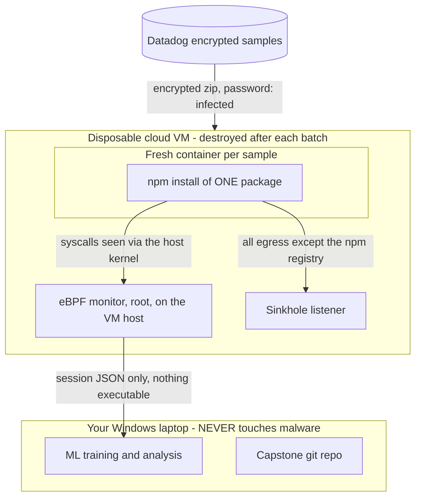

# Capture Harness

Tooling for collecting eBPF session data from npm installs, including live
malware, on a disposable cloud VM.

**Read all of this before running a malware batch.** The benign path is
harmless and you can experiment freely with it. The malware path deliberately
executes live attack code and the safety steps are not optional.

---

## Why this exists

The current corpus cannot support an honest accuracy claim. The malicious class
is six synthetic packages built from one template, and the benign class is real
libraries plus two fixtures from the same template. Any feature that separates
"came from that template" from "real library" looks like a malware signal —
which is why `os_user_dir` shows Cohen's d = 2.70 off a 3% difference.

Cross-ecosystem transfer was the first attempt at a fix and it failed for a
measured reason; see [`../../ml_analysis/QUT_RETIREMENT.md`](../../ml_analysis/QUT_RETIREMENT.md).
The remaining option is a corpus captured by our own monitor, on npm, on one
machine, with one ruler — including real malicious samples.

---

## Architecture



Two nested boundaries:

- **The VM is the blast radius.** Created fresh, destroyed after the batch,
  never reused. Assume everything on it is stolen.
- **The container gives clean state per sample.** This is a data-quality
  requirement as much as a safety one: without it, sample 5's persistence
  mechanism is still present when sample 6 runs, and sample 6's feature vector
  silently records sample 5's behaviour.

---

## The rules

1. **The VM holds nothing worth stealing.** No SSH keys, no git credentials, no
   npm tokens, no cloud CLI config, no personal files, no copy of this repo
   beyond what the harness needs.

2. **Block the cloud metadata endpoint.** Any process on an AWS, GCP or Azure
   VM can query `169.254.169.254` and receive the instance's IAM credentials.
   Malware knows this. `harden-vm.sh` blocks it and `verify-harness.sh` checks
   it from inside a container. Skipping this is the single most common way a
   malware-analysis VM becomes a compromised cloud account.

3. **Use a throwaway cloud account with a hard spending cap**, not your main
   one. Cryptominers spike bills fast.

4. **Set a billing alarm** at a low threshold. It doubles as a miner detector.

5. **Allowlist the npm registry, sinkhole everything else.** Not a hard block:
   redirecting keeps `connect()` succeeding and TCP reaching ESTABLISHED, so
   `tcp_remote_ips`, `tcp_state_transitions` and the rest stay real. A DROP
   truncates behaviour at SYN_SENT and destroys the features being collected.

6. **Never open a sample on Windows.** Keep the Datadog archives encrypted
   until they are inside the VM. Decrypting on your laptop risks AV quarantine
   and accidental execution.

7. **Destroy the VM after each batch.** Do not snapshot and resume. Do not
   reuse it for benign captures afterwards.

8. **Only session JSON leaves the VM.** Never copy back a tarball, a
   `node_modules` directory, or anything executable.

9. **Cloud VM, not the university network.** Skim your institution's
   acceptable-use policy anyway, and send your mentor a one-line note that you
   are doing this deliberately and with containment.

10. **Do not run this on Aniruddha's laptop**, which is how the synthetic
    fixtures run today via `scripts/compare_packages.sh`.

---

## Files

| File | Purpose |
|---|---|
| `harden-vm.sh` | Firewall, metadata block, DNS block, sinkhole redirect, Docker network |
| `sinkhole.py` | Catch-all TCP listener; logs the pre-DNAT destination of every connection |
| `Dockerfile` | Per-sample container, with decoy credentials at the paths malware looks for |
| `capture.sh` | The harness: monitor lifecycle, one container per sample, labelled session output |
| `verify-harness.sh` | Go/no-go checks. Must pass before any malware batch |
| `packages-benign.txt` | ~200 real npm packages for the benign corpus |

---

## Runbook

### Step 0 — Provision the VM

Ubuntu 22.04 or 24.04, 2 vCPU, 4 GB RAM, 40 GB disk is ample. Under a throwaway
account, with a spending cap and a billing alarm already configured.

```bash
sudo apt-get update
sudo apt-get install -y docker.io golang-go clang llvm libbpf-dev \
                        linux-headers-$(uname -r) make jq curl python3 iproute2
sudo systemctl enable --now docker
```

Copy the repo onto the VM and build the monitor:

```bash
make build            # produces ./npm-ebpf-monitor
```

Confirm the probes load before going further:

```bash
sudo ./npm-ebpf-monitor -dry-run
```

### Step 1 — Harden

```bash
sudo bash scripts/capture/harden-vm.sh
```

This blocks `169.254.169.254`, blocks DNS from the capture network, allows
TCP/443 to the resolved npm registry addresses, redirects all other TCP to the
sinkhole, and creates the `capture-net` Docker network.

Start the sinkhole in its own terminal and leave it running:

```bash
sudo python3 scripts/capture/sinkhole.py --port 9999 --log /var/log/capture/sinkhole.jsonl
```

Check the firewall whenever you want:

```bash
sudo bash scripts/capture/harden-vm.sh --status
```

### Step 2 — Verify

```bash
sudo bash scripts/capture/verify-harness.sh
```

Every check must pass. Two matter most:

- **The monitor must see installs happening inside a container.** Detection is
  passive, watching for npm exec events, and it has never been exercised
  against a containerised install. eBPF sees host-namespace PIDs so it should
  work — but if it silently fails, a malware batch produces empty session files
  and the samples cannot be re-run without a new VM.
- **A credential read inside the container must reach the feature vector.**
  The image ships decoy files at `/root/.ssh/id_rsa`, `/root/.aws/credentials`
  and similar, because credential stealers typically check a path exists before
  reading it. Without them, a sample whose whole payload is "steal the SSH key"
  would produce a feature vector showing no credential access.

### Step 3 — Capture the benign corpus

Still zero risk, and it debugs the harness on packages you can re-run freely.

```bash
sudo bash scripts/capture/capture.sh \
  --list scripts/capture/packages-benign.txt \
  --label 0 \
  --out /root/captures/benign
```

Roughly 40 seconds per package, so budget about two hours for the full list.
Check `manifest.csv` in the output directory afterwards and re-run any
`NO_SESSION` rows individually with `--package`.

You can copy this output off the VM freely — no malware has run yet.

### Step 4 — Acquire malware samples

[DataDog/malicious-software-packages-dataset](https://github.com/DataDog/malicious-software-packages-dataset)
— 28,623 samples, Apache 2.0, publicly downloadable, actively maintained.
Samples are zipped with the password `infected`, which is the standard
convention for shipping malware safely.

Prioritise `samples/npm/compromised_lib/`. Hijacked real libraries are exactly
the "normal install plus payload" shape this project targets, and they are the
hardest case — a typosquat that does nothing but exfiltrate is easy by
comparison.

Download and decrypt **on the VM, never on your laptop**:

```bash
mkdir -p /root/samples && cd /root/samples
git clone --depth 1 https://github.com/DataDog/malicious-software-packages-dataset.git
# Decrypt a batch of 10-15 into a working directory:
mkdir -p /root/samples/batch-01
# (per that repo's current instructions; the password is: infected)
```

Optionally also request [Backstabber's Knife Collection](https://dasfreak.github.io/Backstabbers-Knife-Collection/)
(109 npm packages including `event-stream 3.3.6`) by emailing
`ohm@cs.uni-bonn.de` from your university address. Gated and older, so treat it
as supplementary.

### Step 5 — Capture a malware batch

Batches of 10–15, VM destroyed between batches.

```bash
sudo bash scripts/capture/capture.sh \
  --tarball-dir /root/samples/batch-01 \
  --label 1 \
  --out /root/captures/malware/batch-01
```

The script prompts for confirmation on a malicious batch. It also refuses to
start if the firewall is down or the sinkhole is not listening.

### Step 6 — Extract results, then destroy the VM

Copy off **only** the session JSON:

```bash
# from your laptop
scp -r vm:/root/captures/malware/batch-01 ./captures/malware/
scp vm:/var/log/capture/sinkhole.jsonl ./captures/malware/batch-01/
```

Then destroy the VM. Not stop — destroy. Do not snapshot it, do not reuse it
for the next batch.

---

## Output

Each capture writes a labelled session JSON plus a `manifest.csv`:

```csv
package,label,session_file,install_exit,status
lodash,0,npm-1787600001_lodash.json,0,OK
some-hijacked-lib,1,npm-1787600042_some-hijacked-lib.json,1,OK
broken-sample,1,,1,NO_SESSION
```

`install_exit` is recorded but does not fail the capture. A non-zero exit is a
valid observation — plenty of real malware breaks the install it rides on.

The label is written into the JSON as `.label` from the `--label` flag, i.e.
from which corpus the sample came. It is deliberately **not** derived from the
verdict engine: `assign_label` in `ml_analysis/feature_analysis.py` derives
labels from `verdict_level`, so using verdict output as a label source here
would make any subsequent evaluation circular.

---

## Known limitations

**DNS is blocked, so the registry address is pinned.** `harden-vm.sh` resolves
`registry.npmjs.org` at hardening time and `capture.sh` injects that address
into each container via `--add-host`. TLS still works because the hostname
matches the certificate. But the registry is behind a CDN, so if its addresses
rotate mid-batch, installs start failing. Re-run `harden-vm.sh` to re-resolve.

**Packages that download binaries from outside the registry will fail.**
`sharp`, `puppeteer`, `node-sass` and similar fetch prebuilt binaries from
GitHub or a vendor CDN, which the sinkhole intercepts. They are excluded from
`packages-benign.txt` for this reason. A malicious sample that fetches a
second-stage payload will likewise fail to retrieve it — the connection attempt
is recorded, which is the signal we want, but the second stage never runs and
so its behaviour is not in the capture. This is a real limitation of the data,
and worth stating in the writeup rather than glossing over.

**Container isolation is not a security boundary against a determined
attacker.** It is there for clean per-sample state. The VM is the actual
containment boundary, which is why it gets destroyed.

**The sinkhole speaks no protocol.** It accepts, reads up to 512 bytes, logs,
and closes. Malware expecting a TLS handshake or a specific C2 protocol will
error out early. Its behaviour up to that point is still captured.
